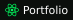
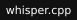
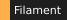

<!-- Banner -->
<p align="center">
  
</p>

<!-- Typing subtitle -->
<p align="center">
  <a href="https://github.com/Mnourkh01">
    
  </a>
</p>

<!-- Primary CTAs -->
<p align="center">
  <a href="https://github.com/Mnourkh01/echoflow-releases/releases/latest">
    
  </a>
  &nbsp;
  <a href="https://portfolio.m-nourkh01.workers.dev">
    
  </a>
</p>

<!-- Quick facts -->
<p align="center">
  
  <a href="https://portfolio.m-nourkh01.workers.dev"></a>
  <a href="https://www.linkedin.com/in/mohammad-nour-al-khusheiny-467bbb3b6/"></a>
  <a href="mailto:m.nourkh01@gmail.com"></a>
  
</p>

<!-- Self-playing snake game, hand-built in animated SVG (no game engine, just SVG + CSS + SMIL) -->
<p align="center">
  
</p>

---

## About Me

```kotlin
val mohammad = Developer(
    role       = "Backend-focused Full-Stack Developer",
    company    = "Folowise",
    location   = "Amman, Jordan",
    experience = "2.5+ years shipping to production",
    speaks     = listOf("Kotlin", "Java", "TypeScript", "PHP", "Rust", "SQL"),
    builds     = listOf("Spring Boot", "Ktor", "NestJS", "Next.js", "Laravel", "Tauri"),
    caresAbout = listOf("clean architecture", "API security", "production readiness"),
    motto      = "Get the fundamentals right before reaching for the clever stuff."
)
```

I started on the backend (Kotlin, Java, Spring Boot) and grew outward into TypeScript, PHP, and Rust across real production work at **Folowise**. My deepest build is a **multi-tenant commerce engine** (foloengine v3) that powers live storefronts. Alongside it I ship my own products, most recently **EchoFlow**, an offline voice-to-text app for Windows. I care about clean architecture, boundary validation, consistent error envelopes, and systems that behave predictably under load. I own work end to end, from API contracts to CI/CD.

<details>
<summary><b>How I approach production systems</b></summary>

<br>

- Input validation at the API boundary, with a single consistent error envelope.
- Stateless JWT auth, refresh-token rotation with reuse detection, and role-based access control.
- Tenant isolation enforced at the data layer (database per tenant, no cross-tenant access paths).
- Observability through structured logging, Sentry, and request tracing across services.
- Small reversible migrations, CI gates, and predictable rollbacks.

</details>

---

## Featured Work

### EchoFlow · offline voice-to-text for Windows

<p>
  <a href="https://github.com/Mnourkh01/echoflow-releases/releases/latest"></a>
  <a href="https://github.com/Mnourkh01/echoflow-releases/releases/latest"></a>
</p>

> Press a hotkey anywhere in Windows, speak, and your words are typed into whatever app you are in. All on your own machine.

EchoFlow runs **OpenAI Whisper locally on your CPU** through `whisper.cpp` (models from `tiny` to `large-v3-turbo`), so your audio never has to leave the device. Push to talk, it transcribes, then auto-types the result. English and Arabic, with optional **translate / clean / prompt** modes powered by cloud providers (OpenAI, Anthropic) when you want them. It keeps a searchable local history in SQLite, updates itself in one click, evicts idle models from memory, and protects its own window from screen capture.

Built with **Rust + Tauri v2** for a tiny, native footprint, a TypeScript UI, `cpal` for audio capture, and SQLite for history.

<p>
  
  
  
  
  
</p>

### Folowise Commerce Engine · foloengine v3

> My deepest project. A multi-tenant commerce **engine**, not just a store.

The engine is the shared brain and control plane for a fleet of storefronts. It owns **licensing, billing, capability authority, update policy, and operational visibility**, while each website owns its own runtime commerce data (database-per-tenant isolation, no cross-tenant leakage). It ships a **server-side PHP SDK** plus a scoped browser JS client, Stripe-hosted checkout, and 30+ commerce HTTP endpoints. ADR-driven architecture, deployed through GitHub Actions CI, observed with Sentry, and already powering live production storefronts (FoloPrint among them).

<p>
  
  
  
  
  
  
</p>

---

## More I've Built

| Project | What it is | Stack |
| --- | --- | --- |
| [**EchoFlow**](https://github.com/Mnourkh01/echoflow-releases) ↗ | Offline voice-to-text desktop app, local Whisper, auto-type, EN/AR, live and downloadable | `Rust` `Tauri` `whisper.cpp` `TypeScript` |
| **Warsha** (private beta) | One Windows workspace for terminals and AI coding agents: Claude Code, Codex and Gemini side by side, every pane and AI conversation survives a restart | `Rust` `Tauri v2` `React` `TypeScript` |
| [**Karmetta**](https://karmetta.com) ↗ | Restaurant platform on the engine: QR table ordering, bilingual menu, kitchen display split by station, live in production | `Laravel` `Alpine.js` `Tailwind` |
| [**FoloPrint**](https://foloprint.folowise.com/) ↗ | Print-on-demand storefront running on the engine, live in production | `Laravel` `Filament` `Vite` |
| [**Inside the Harness**](https://inside-the-harness.pages.dev) ↗ | Free interactive course in English and Arabic on how AI agents really work: 30 levels, hands-on labs, narrated videos | `JavaScript` `HTML` `Cloudflare Pages` |
| [**Adaptive AI Skill Assessment**](https://github.com/Mnourkh01/dynamic-wizard-questions) | 25-question adaptive test for technical roles: AI agents do the language work, tested code owns every number, EN/AR | `Next.js` `TypeScript` `Claude Agent SDK` `Prisma` |
| [**FoloPrint Design Studio**](https://github.com/Mnourkh01/FoloPrint-design-studio) | In-browser print design and mockup studio (production print file plus rendered preview per side) | `TypeScript` `React` `Canvas` |
| **qrfolo** | QR product: REST API, web app, and an analytics pipeline | `NestJS` `Prisma` `PostgreSQL` `Redis` `NATS` |
| [**Spring Boot API Starter**](https://github.com/Mnourkh01/Starter-Project) | Backend template: JWT auth + refresh-token rotation, layered structure, global error envelope | `Spring Boot` `Kotlin` `Flyway` |
| [**URL Shortener**](https://github.com/Mnourkh01/url-shortener) | Short links with a Redis-cached redirect hot path and click analytics | `Kotlin` `Spring Boot` `Redis` |
| [**Java 21 Auth Starter**](https://github.com/Mnourkh01/spring-boot-java-starter) | The auth baseline rebuilt in record-driven Java 21, Docker + CI | `Java 21` `Spring Boot` `Docker` |
| [**Portfolio**](https://github.com/Mnourkh01/portfolio) | Matrix-themed developer portfolio, Next.js 15 + GSAP, full-page digital-rain canvas | `Next.js` `React` `GSAP` |
| [**CarVerse**](https://github.com/Mnourkh01/CarVerse-website-project) | Car discovery platform practice build | `Next.js` `React` `Tailwind` |
| **CMS Core Starter** | Reusable, step-gated CMS backend starter package | `NestJS` `Prisma` `TypeScript` |

---

## Tech Stack

**Languages**


**Backend**


**Frontend & Desktop**


**Data & Infra**


**Tools**


---

## GitHub Activity

<p align="center">
  
</p>

<p align="center">
  
</p>

---

<p align="center">
  
</p>
