# Mohammad Nour Al-Khusheiny

**AI Product Engineer** · Amman, Jordan (UTC+3) · open to remote roles

I build products end to end, from the data model and API to the screens people use. I also build the tooling that lets AI coding agents do real work inside a tested engineering process.

At [Folowise](https://folowise.com) I work on a multi-tenant commerce platform and the restaurant, retail and print products that run on it, and I am the sole developer of **Warsha**, an internal Windows workspace for AI coding agents that I built for myself and a teammate. That code is private, so this page links what you can open and describes the rest plainly.

[Portfolio](https://mohammad-nour.pages.dev) · [LinkedIn](https://www.linkedin.com/in/mohammadnour-al-khusheiny/) · [Email](mailto:m.nourkh01@gmail.com)

## What I work on

**AI agent tooling.** Warsha runs Claude Code, Codex, Gemini, OpenCode and Cursor side by side in real Windows terminals, shows which agent is waiting for you, and brings every session back after a crash or an update. Agents draw plans on a canvas through a local MCP server, and a voice assistant operates the app through 35 tools.

**AI inside products.** The model does the language work and tested code owns every decision. Example: an adaptive skill test where five single-purpose Claude agents return schema-checked JSON and plain TypeScript computes every score, traced end to end with Langfuse.

**Multi-tenant SaaS.** A Laravel commerce engine built from reusable packages, with a control plane that licenses and monitors live storefronts over signed APIs, and the restaurant ordering, booking and admin products built on it. English and Arabic, right to left included.

## Open source

| Project | What it is | What it shows |
|---|---|---|
| [EchoFlow](https://github.com/Mnourkh01/echoflow) | Offline English and Arabic voice to text for Windows. Whisper runs on the device; optional AI rewrite modes. | Rust and Tauri desktop engineering, on-device speech AI, signed auto-update, 17 public releases |
| [Adaptive AI Skill Assessment](https://github.com/Mnourkh01/dynamic-wizard-questions) | 25-question adaptive test for technical roles, scored out of 1000 by topic. | Agents with structured output, deterministic scoring, LLM tracing, about 136 tests |
| [FoloPrint Design Studio](https://github.com/Mnourkh01/FoloPrint-design-studio) | Browser design editor for print-on-demand with server-rendered mockups. | TypeScript monorepo (NestJS, Next.js, Prisma), shared geometry between editor and server, about 280 tests, CI |
| [URL Shortener](https://github.com/Mnourkh01/url-shortener) | Short links with a Redis-cached redirect path and click analytics. | Spring Boot and Kotlin, cache-aside, rate limiting, Flyway, tests and CI |

## Company work (private source)

**Warsha**, sole developer, internal tool in private beta, used daily by me and a teammate. Rust core (ConPTY terminals, Windows job objects, crash-safe persistence) behind Tauri 2, with a React and TypeScript UI. Measured on a reference machine: keystroke to screen p95 3.5 ms, ten idle panes at 1.25 percent of one CPU core. 23 beta releases, 1,100+ Rust tests, 1,000+ frontend tests, 175 written architecture decisions.

**FoloEngine**, co-built. Laravel engine of reusable Composer packages and a control plane that issues licences, grants features per site through a fail-closed gate and verifies HMAC-signed health reports from each store. I started its V3 codebase and wrote about half of its commits. It runs live stores: [Printman](https://printmanjo.com), where I built the admin, orders and checkout, and [Opti4Club](https://opti4club.com), whose WordPress to Laravel rebuild I led. It has since grown into the company's Platform V4.

**Karmetta on Platform V4**, team of four. I authored 84 merged pull requests in 13 days: table booking on a floor-plan picker, QR and counter ordering, the kitchen board, and integrity fixes for bookings and the cash drawer. The V4 version is launching soon; the current Karmetta is live at [karmetta.com](https://karmetta.com).

## How I work

- A short written plan before code, and a decision record when the choice is hard to undo.
- AI coding agents write much of the first draft. I own the design, the review and what ships.
- Changes pass automated checks, then a browser, device or API check where the change has one, then code review.
- Numbers here are counted from releases, tests or measurements.

## Stack

- **Languages:** TypeScript, PHP, Rust, Kotlin, Java, SQL
- **Backend:** Laravel, Node.js (Hono, NestJS), Spring Boot, Ktor, PostgreSQL, MySQL, SQLite, Redis
- **Frontend and desktop:** React, Next.js, Tailwind, Alpine.js, Tauri 2, xterm.js
- **AI:** Claude Agent SDK, MCP servers, tool calling, structured output with Zod, Langfuse tracing, whisper.cpp, Gemini Live
- **Delivery:** GitHub Actions, Docker, Cloudflare, Sentry, Pest, PHPUnit, Vitest, Playwright

## Activity

Most of my work happens in private company repositories, so the public graph shows only part of it. This picture is drawn from my commit dates, private work included (counts only, no code):

  

